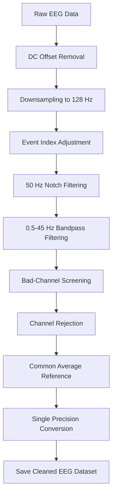
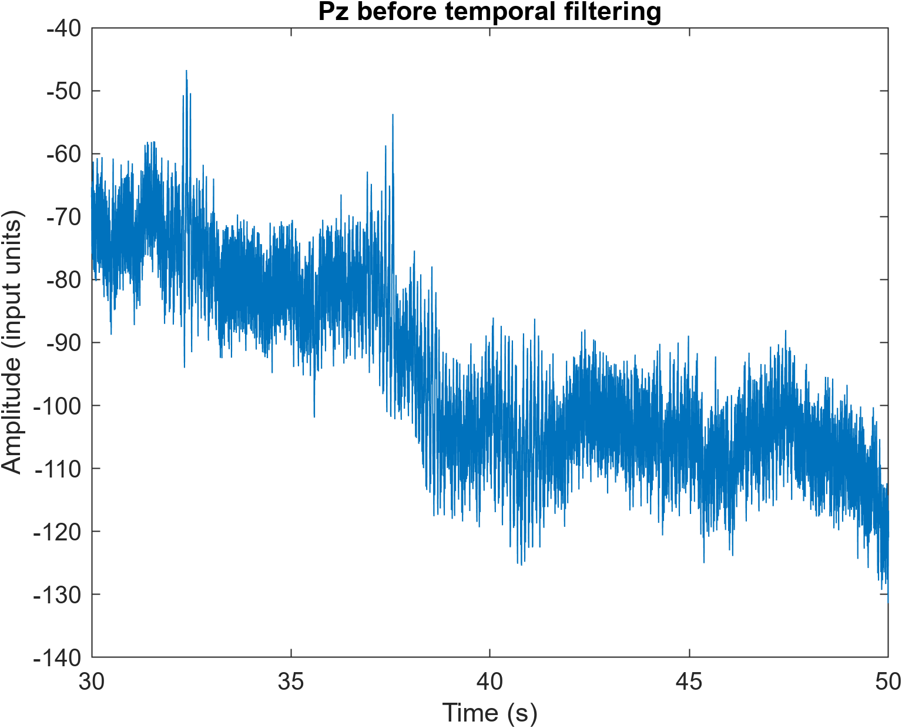
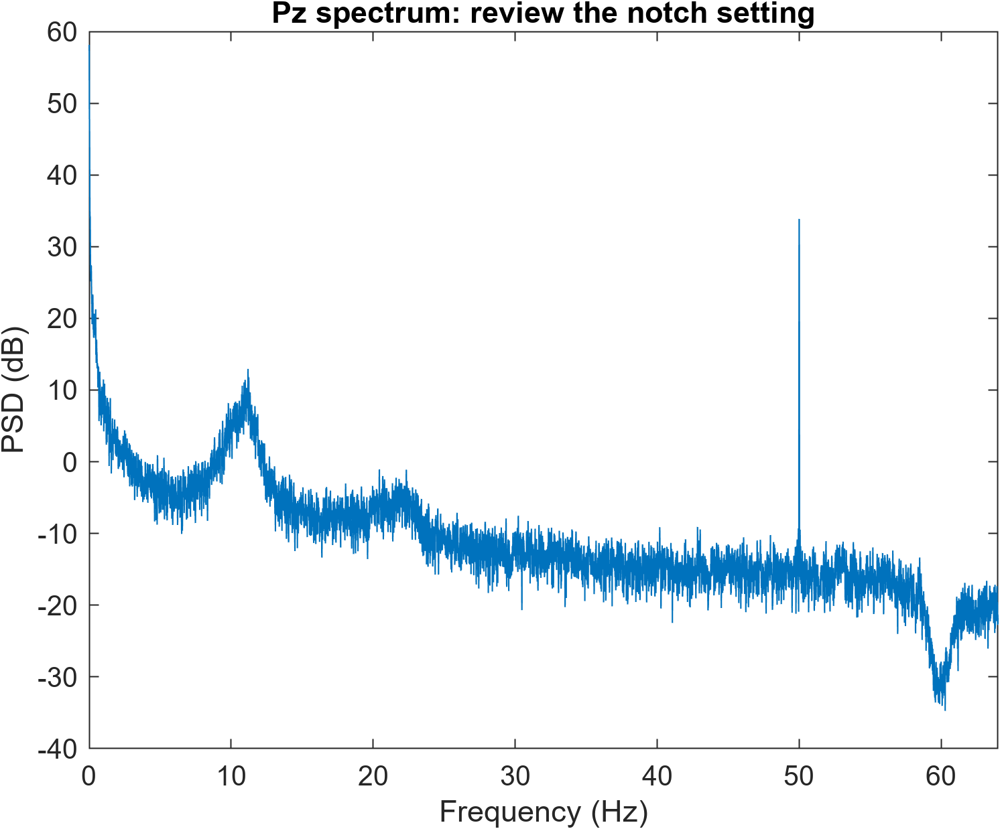
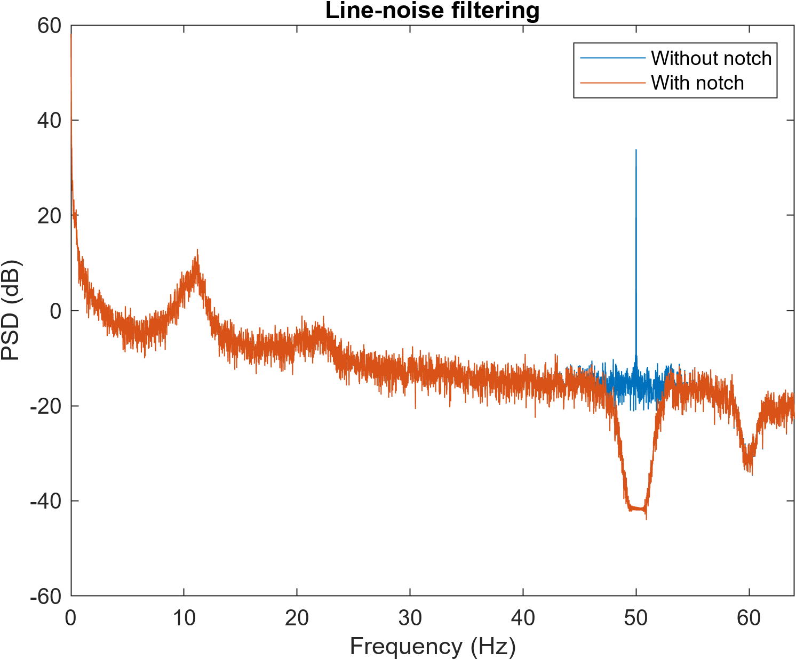
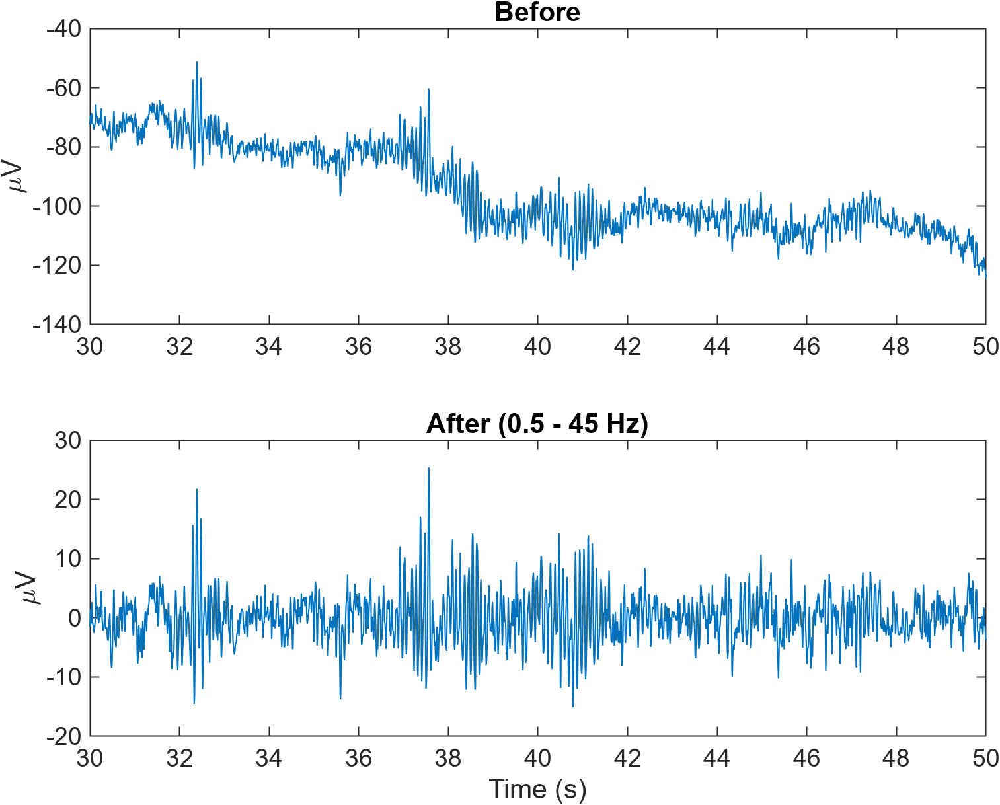
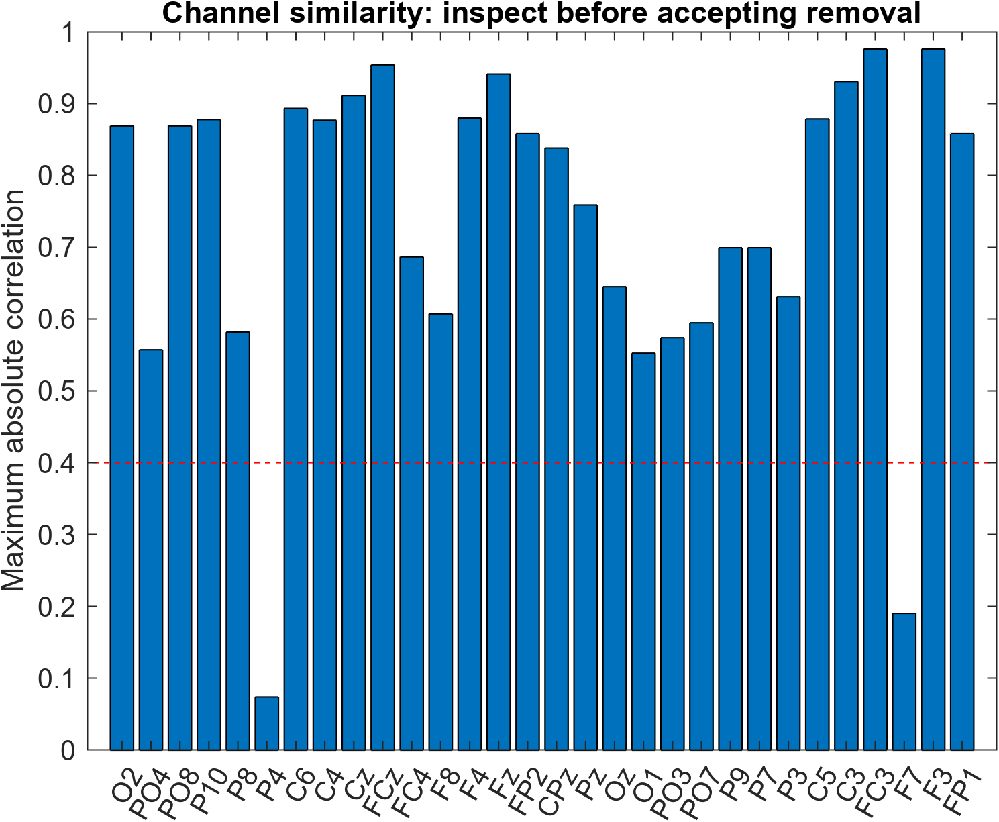

# Continuous EEG Preprocessing Pipeline


A MATLAB-based pipeline for preprocessing continuous multi-channel electroencephalography (EEG) recordings. The pipeline includes DC offset removal, resampling, line-noise suppression, bandpass filtering, automated channel screening, and Common Average Reference (CAR) re-referencing.

The project is designed to prepare continuous EEG data for downstream analyses, including Event-Related Potentials (ERP) and time-frequency analysis.

**Note:** This is an educational and research preprocessing project. The pipeline and its automated channel-screening criteria should be evaluated for the specific dataset and research application before use.

---

## Table of Contents

1. [Project Overview](#project-overview)
2. [Pipeline Architecture](#pipeline-architecture)
3. [Methods and Signal Processing](#methods-and-signal-processing)
4. [Diagnostic Results](#diagnostic-results)
5. [Input and Output Data Structure](#input-and-output-data-structure)
6. [Repository Structure](#repository-structure)
7. [Requirements](#requirements)
8. [How to Run](#how-to-run)
9. [Data Privacy](#data-privacy)
10. [Limitations](#limitations)

---

## Project Overview

This project implements a continuous EEG preprocessing workflow in MATLAB.

The main processing steps are:

- Removal of channel-wise DC offsets.
- Downsampling from the original sampling frequency to 128 Hz.
- Alignment of event sample indices after resampling.
- Suppression of 50 Hz power-line interference.
- Bandpass filtering between 0.5 and 45 Hz.
- Automated bad-channel screening using maximum absolute cross-channel correlation.
- Common Average Reference (CAR).
- Conversion of EEG data to single precision.
- Saving the preprocessed dataset for further analysis.

The pipeline produces a cleaned EEG dataset and diagnostic figures that help evaluate the preprocessing stages.

## Pipeline Architecture



## Methods and Signal Processing

### 1. DC Offset Removal

The temporal mean is calculated and subtracted from each EEG channel. This reduces constant channel-wise offsets before subsequent signal processing.

The Pz channel is identified using its channel label rather than a fixed row index. This helps avoid assumptions about the ordering of electrodes.

### 2. Resampling to 128 Hz

The original EEG data are downsampled to 128 Hz.

The resampling factors are calculated using MATLAB's `rat()` function:

```matlab
[p, q] = rat(newRate / oldRate);
```

MATLAB's `resample()` function applies an anti-aliasing FIR filter before changing the sampling rate.

The EEG matrix is transposed during resampling because MATLAB processes columns independently. The matrix is then restored to its original channel-by-sample orientation.

**Event sample adjustment**

Event indices must also be converted to the new sampling frequency to maintain their temporal alignment with the resampled EEG data. The conversion accounts for MATLAB's 1-based sample indexing:

```matlab
events = round((events - 1) * newRate / oldRate) + 1;
```

The first sample therefore remains at index 1.

### 3. Power Spectral Density and 50 Hz Notch Filtering

Power Spectral Density (PSD) is estimated using Welch's method with MATLAB's `pwelch()` function.

The Pz channel is used to inspect the frequency spectrum and identify possible 50 Hz electrical interference.

A Butterworth bandstop filter is designed to attenuate frequencies between 48 and 52 Hz.

Filter characteristics:

- Filter type: Butterworth bandstop.
- Design order parameter: 2.
- Stopband: 48–52 Hz.
- Filtering function: `filtfilt()`.

For a bandstop design, the bandstop transformation produces a fourth-order transfer function from the specified second-order design parameter. Forward-backward filtering with `filtfilt()` applies the filter in both directions, producing zero net phase shift in the interior of the signal and changing the magnitude response. It does not eliminate filtering-related amplitude changes or edge effects.

### 4. Bandpass Filtering (0.5–45 Hz)

Two Butterworth filters are used to restrict the EEG frequency range.

**High-pass filter**

- Cutoff frequency: 0.5 Hz.
- Design order: 2.
- Purpose: Attenuation of slow signal fluctuations and baseline drift.

**Low-pass filter**

- Cutoff frequency: 45 Hz.
- Design order: 4.
- Purpose: Attenuation of high-frequency activity, including some muscle-related and environmental noise.

Both filters are applied using `filtfilt()` to avoid net phase delay.

The resulting signal is intended to retain EEG activity within the selected 0.5–45 Hz analysis band. The selected frequency range is an analysis choice and may need modification depending on the research question. In particular, the 0.5 Hz high-pass cutoff can attenuate slow ERP components.

### 5. Bad-Channel Screening Using Maximum Cross-Channel Correlation

A correlation-based approach is used to identify potentially poor-quality EEG channels.

The absolute Pearson correlation matrix is calculated between all channels. Self-correlations are excluded by setting the diagonal elements to zero.

For each channel, the maximum absolute correlation with any other channel is calculated. A threshold of 0.4 is used:

- Score greater than or equal to 0.4: channel is retained.
- Score below 0.4: channel is flagged for rejection.

Channels identified for rejection are removed from the EEG data, channel labels, and electrode coordinate matrix.

**Important methodological limitation:** This method uses the maximum correlation with any other channel, not specifically neighboring electrodes based on their physical scalp positions. It should therefore be interpreted as a simple correlation-based screening heuristic rather than a complete bad-electrode detection method. The threshold is dataset-dependent, and flagged channels should be visually inspected before final rejection.

### 6. Common Average Reference (CAR)

After bad-channel rejection, the remaining EEG channels are re-referenced using the Common Average Reference method.

At each time point, the average signal across retained channels is calculated and subtracted from each channel. Bad-channel rejection is performed before CAR to reduce the influence of rejected channels on the reference signal.

The implementation also checks the residual spatial mean across channels as a numerical verification of the referencing procedure.

### 7. Precision Conversion and Data Saving

Before saving the final dataset:

- EEG data (`data`) are converted to `single` precision (32-bit floating point).
- Event indices (`events`) are retained as `double` precision.
- Sampling frequency and channel metadata are preserved.

Single precision reduces memory requirements. Its suitability should still be evaluated for the intended downstream analysis.

The final dataset is saved locally as:

```text
data/Task1_clean.mat
```

---

## Diagnostic Results

The following figures illustrate the EEG signal during different preprocessing stages. Each image is displayed at 50% of the available content width.

### 1. Raw EEG Signal (Pz)

<p align="center">
  
</p>

The raw Pz signal is inspected in the time domain to evaluate baseline fluctuations and signal characteristics before temporal filtering.

### 2. Power Spectral Density Before Notch Filtering

<p align="center">
  
</p>

Welch PSD estimation is used to inspect the frequency spectrum and identify possible power-line interference around 50 Hz.

### 3. Notch Filter Comparison

<p align="center">
  
</p>

The PSD before and after notch filtering is compared to evaluate attenuation in the 48–52 Hz frequency range.

### 4. Bandpass Filter Comparison

<p align="center">
  
</p>

The Pz signal before and after bandpass filtering is compared to inspect the effects of removing slow fluctuations and high-frequency components.

### 5. Channel Correlation Screening

<p align="center">
  
</p>

The maximum absolute cross-channel correlation scores are displayed for each electrode. The horizontal threshold indicates the 0.4 criterion used for automated channel screening.

**Recorded example:** The documented processing run identified P4 and F7 as channels below the selected threshold. These results are specific to the example recording and should not be interpreted as universal bad-channel classifications.

---

## Input and Output Data Structure

### Input Dataset

The original dataset is expected to be named:

```text
raw_witness2.mat
```

The expected variables are:

| Variable | Description |
|---|---|
| `data` | Continuous EEG matrix (channels × samples) |
| `srate` | Original sampling frequency |
| `chanlabels` | Electrode labels |
| `event_sample` | Original event sample indices |
| `pos` | Electrode spatial coordinates |
| `suspect` | Recording-related metadata, if available |

The input data must contain the variables and dimensions expected by the MATLAB script.

### Output Dataset

The cleaned dataset is saved as:

```text
Task1_clean.mat
```

| Variable | Description | Output format |
|---|---|---|
| `data` | Preprocessed and CAR-referenced EEG | `single` |
| `srate` | New sampling frequency (128 Hz) | `double` |
| `labels` | Retained electrode labels | Cell array |
| `events` | Resampled event sample indices | `double` |
| `pos` | Retained electrode coordinates | `double` |
| `suspect` | Recording metadata, if present | Original type |

The number of channels in the output depends on the result of bad-channel screening.

The EEG amplitude units are inherited from the input dataset. They must be verified from the original recording documentation.

---

## Repository Structure

```text
eeg-preprocessing/
│
├── README.md
├── .gitignore
│
├── preprocess_eeg.m
├── preprocess_eeg.mlx
├── preprocess_eeg.pdf
│
├── data/
│   └── README.md
│
└── figures/
    ├── 01_raw_pz_time.png
    ├── 02_pz_psd_before_notch.png
    ├── 03_pz_psd_notch_comparison.png
    ├── 04_pz_bandpass_comparison.png
    └── 05_channel_correlation_screening.png
```

### File Descriptions

| File | Description |
|---|---|
| `preprocess_eeg.m` | Main MATLAB preprocessing script |
| `preprocess_eeg.mlx` | MATLAB Live Script with explanations and outputs |
| `preprocess_eeg.pdf` | PDF report exported from the Live Script |
| `figures/` | Diagnostic figures generated during preprocessing |
| `data/` | Local directory for input and output datasets |
| `.gitignore` | Excludes restricted data files from Git |
| `README.md` | Project documentation |

---

## Requirements

### Software

- MATLAB R2022b was used for the documented project.
- Signal Processing Toolbox is required for functions such as `resample()`, `butter()`, `filtfilt()`, and `pwelch()`.

Compatibility with other MATLAB versions has not been independently tested.

### Input Requirements

- An authorized copy of the original EEG recording.
- Correct channel labels and sampling frequency.
- Event sample indices corresponding to the original recording.
- Electrode coordinates when spatial metadata are required.

---

## How to Run

### 1. Clone the Repository

```bash
git clone https://github.com/ParhamMahmoudi/eeg-preprocessing.git
```

### 2. Open the Project

Open MATLAB and navigate to the repository directory:

```matlab
cd('eeg-preprocessing')
```

### 3. Prepare the Dataset

Place your authorized original recording inside the local `data` folder:

```text
data/raw_witness2.mat
```

Do not upload restricted recording data to the public repository.

### 4. Run the Preprocessing Script

Execute the main script:

```matlab
preprocess_eeg
```

### 5. Check the Results

After successful execution, inspect the diagnostic figures and MATLAB Command Window output.

The cleaned dataset should be saved locally at:

```text
data/Task1_clean.mat
```

Verify the output variables, sampling frequency, event indices, retained channels, and signal dimensions before using the dataset in further analyses.

---

## Data Privacy

EEG recordings may contain sensitive and potentially identifiable information.

For this reason:

- Raw EEG datasets should not be uploaded to a public repository without explicit permission.
- Preprocessed EEG datasets should also be treated as restricted research data.
- Hospital records, participant identifiers, and confidential metadata must not be published.
- Diagnostic figures and derived outputs should only be shared when their publication is authorized and they do not reveal identifiable or confidential information.
- The `.gitignore` file should exclude `.mat` files from ordinary Git tracking.

**Important:** `.gitignore` does not remove files that have already been committed or uploaded. Always inspect the files being committed before publishing the repository.

---

## Limitations

1. The correlation-based channel-screening method is a heuristic and does not independently establish whether an electrode is physiologically or technically bad.
2. The 0.4 correlation threshold may not be appropriate for every EEG dataset.
3. Zero-phase filtering avoids net phase delay but does not eliminate amplitude distortion, edge effects, or changes in waveform morphology.
4. The 0.5–45 Hz frequency range may not be appropriate for all ERP or oscillatory analyses.
5. Common Average Reference performance depends on the quality and spatial distribution of the retained electrodes.
6. The pipeline has been evaluated using the documented example recording, but independent validation across multiple datasets is still required.

---

## Author and Project Information

**Project:** Continuous EEG Preprocessing Pipeline  
**Programming Language:** MATLAB  
**Research Area:** EEG Signal Processing and Neuroinformatics  
**Main Applications:** EEG preprocessing, signal quality inspection, ERP preparation, and time-frequency analysis.  
**Documentation:** See `preprocess_eeg.pdf` for the exported code, processing outputs, and diagnostic results.
